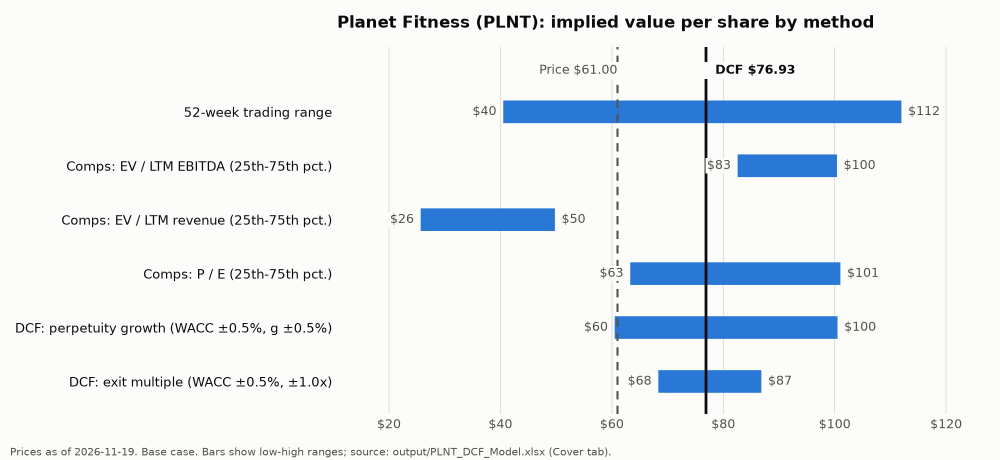

# Planet Fitness (NYSE: PLNT) — DCF valuation

**Base-case DCF value: $76.93 per share vs. $61.00 share price (close on 2026-11-19), +26%.**
Perpetuity-growth method $76.49 · exit-multiple method $77.38 · scenario range $59.40 (Downside) to $97.48 (Upside).

| Method | Value per share |
|---|---|
| DCF, perpetuity growth (WACC ±0.5%, g ±0.5%) | $60 – $100 |
| DCF, exit multiple (WACC ±0.5%, 12.0x ±1.0x) | $68 – $87 |
| Comps, EV / LTM EBITDA (peer 25th–75th percentile) | $83 – $100 |
| Comps, P / E (peer 25th–75th percentile) | $63 – $101 |
| 52-week trading range | $40.50 – $111.97 |

**The debate:** the market prices in about 3% growth. At $61 the reverse DCF implies **2.8% annual revenue growth** at base-case margins, or a 41.1% EBITDA margin (base: 45.0%), or 1.9% terminal growth (base: 3.0%). The base case instead assumes management guidance in the near term: revenue grows about 7.6% in FY2027, then fades to about 4% by FY2031 as club openings slow and same-club sales settle at about 2.5%.

**The three assumptions that move the answer most** (value-per-share swing, base case):
1. **WACC (7.96%)**: ±0.5% moves value by −$9.45 / +$11.57 under the perpetuity method.
2. **Terminal value (g = 3.0%, exit multiple 12.0x)**: g ±0.5% moves value by −$7.98 / +$9.77; the exit multiple ±1.0x moves it by ±$7.01.
3. **Operating levers.** Each of these is worth about ±$2.5 per share:
   - capex ±1pp of revenue
   - corporate-club margin ±2pp
   - franchise same-club sales ±1pp a year (FY2027–31)

<picture>
  <source media="(prefers-color-scheme: dark)" srcset="docs/football_field_dark.png">
  
</picture>

> Educational model built from public filings and free market data. **Not investment advice.**

---

## What's in the repo

| Path | What it is |
|---|---|
| `output/PLNT_DCF_Model.xlsx` | The model: 12 tabs, every calculated cell a live Excel formula (3,035 formulas). Blue = input, black = formula, green = link from another tab. |
| `output/PLNT_Investment_Memo.pdf` | One-page memo: business, thesis, valuation, risks. |
| `src/` | Python that downloads the data, builds the workbook with openpyxl, and verifies it. |
| `data/inputs/` | Peer LTM data and the price panels used for beta (each value carries its XBRL tag and accession number). |
| `output/*.json` | Verification results (`verification_summary`, `excel_check`, `source_check`, `tornado`). |

**Workbook tabs:**
- **Cover:** summary, football field and the overall check status.
- **Assumptions:** the scenario switch drives every forecast driver.
- **Historicals:** FY2021–FY2025, nine months to Sep 2025 and Sep 2026, LTM, with normalizations.
- **Projections:** the club and same-club-sales revenue build and unlevered FCF.
- **WACC**
- **Beta:** SLOPE/RSQ regressions on weekly and monthly returns.
- **Terminal Value**
- **Equity Bridge**
- **Sensitivities:** formula grids, not Excel Data Tables.
- **Comps**
- **Reverse DCF:** solved in-sheet with a 40-step bisection.
- **Checks**

## Method

**Revenue build.** Revenue is built by segment from disclosed drivers:
- **Franchise:** royalty per average franchise club × average franchise clubs. Royalty per club grows with franchise same-club sales, less a drag for new clubs that are still ramping up.
- **Other franchise fees:** fees, equipment placement and HVAC, modeled per club.
- **National advertising fund (NAF):** set as a share of royalties. It is a pass-through (its revenue is spent on advertising), and its contribution rose from 2% to 3% of member dues in 2026.
- **Corporate-owned clubs:** revenue per average corporate club × average corporate clubs.
- **Equipment:** revenue per average franchise club, which tracks the 5–9-year re-equip cycle.

FY2026E is calibrated to the 2026 outlook in the 8-K filed 2026-11-05. The model shows revenue +7.9% (guidance about 8%), adjusted EBITDA +6.5% (guidance about 6.5%), capex +15% and D&A +7%.

**Growth fade (base case, revenue excl. NAF)**

| | FY2027E | FY2028E | FY2029E | FY2030E | FY2031E |
|---|---|---|---|---|---|
| Net new franchise clubs | 145 | 125 | 110 | 95 | 80 |
| Net new corporate clubs | 20 | 16 | 12 | 10 | 8 |
| Average franchise club growth | 5.4% | 4.8% | 4.0% | 3.3% | 2.8% |
| Same-club sales | 3.0% | 2.75% | 2.5% | 2.5% | 2.5% |
| **Revenue growth** | **7.6%** | **6.6%** | **5.4%** | **4.6%** | **4.2%** |

**Margins and cash flow.** Margins are set by segment, using company-reported segment adjusted EBITDA (FY2023 onward). Stock-based compensation is not added back, and operating leases are treated as rent inside EBITDA. Cash taxes are 26% of EBIT. Capex fades from 14.5% to 11.5% of revenue excl. NAF, and net working capital is −4% of revenue.

**Discounting.** The valuation date is 2026-11-20. Cash flows use the mid-year convention, with a stub period for the 41 days left in FY2026. The two terminal values are both stated at the end of FY2031:
- **Gordon growth** at g = 3.0%. Its implied exit multiple is 11.9x.
- **Exit multiple** of 12.0x FY2031E EBITDA. Its implied perpetuity growth is 3.05%.

The headline averages the two methods.

**WACC 7.96%**

| Input | Value | Basis |
|---|---|---|
| Risk-free rate | 5.04% | 10-year Treasury |
| Equity risk premium | 4.41% | Damodaran implied ERP, Nov 2026 |
| Beta | 0.95 | Peer-median unlevered beta of 0.73 (5-year monthly, Hamada), relevered at the peer-median 29.5% debt to capital |
| Cost of equity | 9.24% | CAPM |
| Pre-tax cost of debt | 6.65% | 7-year Treasury today (4.94%) + 1.71% spread at which PLNT's 7-year securitized notes priced in Dec 2025 (5.649% coupon vs. a 3.94% 7-year Treasury) |
| After-tax cost of debt | 4.92% | 26% tax rate |

Cross-checks on the cost of debt:
- LTM interest expense divided by average debt gives 5.1%.
- The notes' weighted coupon is 5.0%.
- The notes trade at 95.7% of par, which means market yields are above the coupons.

**Equity bridge** (balance sheet at 2026-09-30):

| Item | Treatment |
|---|---|
| Cash, marketable securities and non-operating investments | Added |
| Securitized notes at principal ($2,496.8M) and Variable Funding Notes ($75.0M) | Deducted |
| Finance leases | Deducted |
| Tax receivable agreement (TRA) payable ($361.9M) | Deducted |
| Net deferred tax asset ($367.7M), the tax shield that funds the TRA | Added (toggle) |
| Be-Fit, bought 2026-10-30 for $112.0M cash plus a $2.8M earn-out | Added at cost, so it nets to zero |
| Restricted cash | Excluded |
| Operating lease liabilities | Excluded |

Diluted shares are 74.83M: Class A plus exchangeable Class B, RSUs, PSUs, and options under the treasury stock method at the current price.

**Comparable companies.** Seven peers, on last-twelve-months (LTM) multiples only. Forward consensus estimates are not available from free sources.

| Peer | EV / LTM EBITDA | P / E |
|---|---|---|
| Life Time (LTH) | 13.0x | 25.0x |
| Xponential (XPOF) | 15.7x | NM |
| Domino's (DPZ) | 14.9x | 19.0x |
| Wingstop (WING) | 22.4x | 35.0x |
| Wendy's (WEN) | 11.1x | 16.9x |
| Choice Hotels (CHH) | 16.7x | 25.9x |
| Valvoline (VVV) | 14.9x | 54.7x |
| **Peer median** | **14.9x** | **25.4x** |
| **PLNT** | **11.5x** | **19.7x** |

The DCF implies 13.4x LTM adjusted EBITDA. Driven Brands was screened out: it filed a late-filing notice (NT 10-Q) on 2026-11-06 and reports discontinued operations.

## Verification

| Check | Result |
|---|---|
| Workbook recalculated in Microsoft Excel vs. the open-source `formulas` engine, every formula cell | 3,035 / 3,035 match (max difference 4e-12) |
| Independent Python re-implementation (`src/verify.py`; reads the raw inputs, not the workbook) vs. the workbook, for Base, Upside and Downside | 200 / 200 outputs match to the cent in each scenario |
| Every hard-coded input re-read from its source (`src/check_sources.py`): SEC data tags, filing text, Treasury, Damodaran, Nasdaq | 425 / 425 confirmed |
| Built-in checks (balance sheets balance, club roll-forwards tie, segments sum, sensitivity centre = output, bridge arithmetic, guidance calibration) | All OK; 2 warnings (terminal value > 75% of EV) |

## Sources

| Input | Source | As of |
|---|---|---|
| Historical financials, segments, club counts, debt, TRA, shares | PLNT 10-K FY2021–FY2025 and 10-Q Q3 2025 / Q3 2026 via SEC EDGAR (companyfacts XBRL API + filing documents); tag or filing cited per cell | Filed through 2026-11-05 |
| 2026 outlook | 8-K, Exhibit 99.1 (accession 0001637207-26-000047) | 2026-11-05 |
| Peer financials | SEC companyfacts, LTM = FY + YTD − prior YTD; tag and accession in `data/inputs/peers_raw.csv` and the Comps tab | Latest 10-Q / 10-K |
| Share prices (PLNT and peers), 52-week range | Nasdaq.com historical quotes (Stooq now serves a JavaScript bot check, so it is not usable as a CSV source) | Close on 2026-11-19 |
| S&P 500 index for beta | FRED series SP500 (S&P Dow Jones Indices) | Through 2026-11-13 (weekly) / 2026-10-31 (monthly) |
| Risk-free rate and Treasury curve | U.S. Treasury daily par yield curve (treasury.gov) | 2026-11-19; 2025-12-15 for the debt spread |
| Equity risk premium | Damodaran, `ERPbymonth.xlsx`, "T12m with sustainable payout" (pages.stern.nyu.edu/~adamodar) | 2026-11-01 |
| Tax rate (26%) | PLNT's own assumed rate in its FY2025 adjusted net income reconciliation | 10-K FY2025 |

## Limitations

- **Terminal value is about 80% of enterprise value** (79.9% perpetuity, 80.1% exit), above the 75% comfort threshold flagged in Checks. That is typical for a franchisor still growing its club base at an 8% WACC, but it means the answer depends heavily on the long-run assumptions. The sensitivity grids and reverse DCF show how much.
- **Beta.** PLNT's own 2-year weekly beta is −0.01 (R² ≈ 0). The stock fell from about $108 to about $50 in 2026 on company-specific news (same-club sales slowed from 6.8% in FY2025 to 1.5% in Q3 2026, and the CFO changed), so the regression measures idiosyncratic risk rather than market risk. The model uses the peer-median relevered beta of 0.95, cross-checked by PLNT's own 5-year monthly beta of 1.02.
- LTM multiples only (no free source for forward estimates). Peer EBITDA is unadjusted GAAP (operating income + D&A), so one-offs are not normalized across peers.
- The latest equity-award counts are from the FY2025 10-K. The cover-page share count is dated 2026-10-30, while the cash and debt are as of 2026-09-30.
- The TRA payable and deferred tax asset are taken at book value (undiscounted). They roughly offset, and a toggle removes the deferred tax asset.
- No size premium: Kroll/CRSP data is paid. There is an input cell to test one.
- The strategic review of domestic corporate-owned clubs (announced 2026-11-05) is not modeled. A refranchising would move EBITDA from corporate to franchise economics.

## How to reproduce

```bash
python3 -m venv .venv && .venv/bin/pip install -r requirements.txt
export SEC_USER_AGENT="Your Name your@email"   # SEC fair-access policy; or put it in private/sec_user_agent.txt
./run_all.sh
```

Downloads are cached in `data/raw/` (SEC requests are throttled to 4 per second), so re-runs don't fetch again. Large SEC files are git-ignored and re-fetched on first run. The small market files are committed so the exact inputs are reproducible. To change a forecast, edit `src/assumptions.py`, or flip the scenario switch on the Assumptions tab in Excel.
